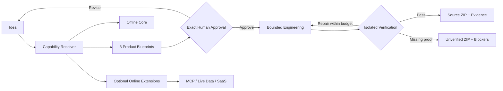

<p align="center">
  
</p>

<h1 align="center">AI Product Factory</h1>

<p align="center">
  <strong>Ideas → capabilities → approved product contracts → working source → isolated verification.</strong>
</p>

<p align="center">
  <a href="https://github.com/logeshv586-code/AIproductfactory/actions/workflows/ci.yml"></a>
  <a href="https://github.com/logeshv586-code/AIproductfactory/stargazers"></a>
  <a href="https://github.com/logeshv586-code/AIproductfactory/forks"></a>
  <a href="https://github.com/sponsors/logeshv586-code"></a>
</p>

<p align="center">
  <a href="#-start-here">Start</a> ·
  <a href="#-the-q--answer-view">Why it is different</a> ·
  <a href="#-capability-factory">Capabilities</a> ·
  <a href="#-product-blueprints">Products</a> ·
  <a href="#-contribute-a-missing-layer">Contribute</a> ·
  <a href="https://github.com/sponsors/logeshv586-code">Sponsor</a>
</p>

---

## ⚡ Start here

**AI Product Factory is not a prompt-to-template generator.** It is an open product-engineering system that reasons about an idea, composes reusable capabilities, creates multiple product directions, locks the chosen direction as an exact contract, builds the approved product, and verifies observable behavior before delivery.

The default architecture is **offline-first**:

- local models through **Ollama** or **LM Studio**
- local RAG, memory, files and databases
- local voice, vision, analytics and automation where possible
- optional **MCP / live web / GitHub / SaaS / business APIs** only when the user explicitly enables connected mode
- local fallbacks so a connected feature does not silently become a core dependency

> **Core rule:** the model can propose and implement. The Factory owns scope, approval, acceptance and release evidence.

---

## ❓ The Q → Answer view

### Q — Why another AI builder?

**A — Because generating code is not the same as engineering a product.**

Most builders optimize for:

`prompt → code`

AI Product Factory is designed around:

`idea → capability composition → product plans → exact approval → engineering → isolated verification → source + evidence`

---

### Q — Does it need the internet?

**A — No. Offline-first is the default.**

A product can use local models, local retrieval, local storage and local tools. When the user enables online extensions, the same product can attach MCP servers, live research, GitHub, email/calendar, SaaS connectors or domain APIs.

```text
OFFLINE CORE
  Local LLM
  Local RAG
  Memory
  SQLite / DuckDB / Vector DB
  Voice / Vision
  Analytics
  Automation
  Generative UI
       │
       └──── optional extension gateway
                    │
                    ├─ MCP
                    ├─ GitHub
                    ├─ Live web
                    ├─ Email / Calendar
                    ├─ SaaS
                    └─ Domain APIs
```

---

### Q — Can a model silently change the requested product while building?

**A — No.**

The selected plan is canonicalized and bound to a contract hash. If the product brief changes, approval must happen again.

---

### Q — Does “the app starts” mean the product is finished?

**A — No.**

The Factory separates generated implementation from protected acceptance. A build is only presented as verified when the available isolated checks prove the approved behavior.

---

### Q — Can people extend the Factory without rewriting it?

**A — That is the design goal.**

Capabilities, product blueprints, model providers, online extensions, verification layers and deployment adapters are meant to evolve independently.

---

## 🧠 Capability Factory

Instead of maintaining hundreds of copied demos, the Factory normalizes reusable patterns into composable capabilities.

| Layer | Examples |
|---|---|
| **Models** | Ollama, LM Studio, hosted providers when enabled |
| **Agents** | single-agent, specialist teams, planner/reviewer loops, trust gates |
| **RAG** | local, hybrid, agentic, graph, multimodal |
| **Memory** | session memory, semantic memory, graph memory |
| **Data** | CSV/Excel analysis, DuckDB, SQLite, local analytics |
| **Developer AI** | codebase intelligence, dependency diagnostics, critique/repair |
| **UI** | generative UI, dashboard canvas, product-specific React flows |
| **Tools** | local MCP, browser/RPA, approved tool routing |
| **Voice** | local ASR → agent/RAG → local TTS |
| **Vision** | local VLM, OCR, OpenCV, video processing |
| **Automation** | scheduled/event-driven agents, local workflow execution |
| **Optimization** | context budgeting, local fine-tuning / LoRA workflows |

See [Offline Capability Factory](./docs/OFFLINE_CAPABILITY_FACTORY.md).

---

## 🧩 Product blueprints

The capability layer can be composed into reusable product families without turning them into fixed templates.

Current blueprint directions include:

| Product family | Typical composition |
|---|---|
| **Private Knowledge Assistant** | local LLM + hybrid RAG + graph citations + memory |
| **Offline Research Workspace** | local corpus + agentic RAG + specialist agents + evidence |
| **Recruitment Copilot** | resume parsing + matching + interview planning + memory |
| **Local Data Analyst** | CSV/Excel/DuckDB + charts + local reasoning |
| **Codebase Copilot** | local git + code intelligence + review + repair + verification |
| **Customer Support AI** | private docs + RAG + memory + generative UI |
| **Voice Support AI** | local ASR + RAG + local LLM + TTS |
| **Document Intelligence** | OCR/VLM + structured extraction + validation + evidence |
| **Dashboard Builder** | data analysis + chat-to-dashboard composition |
| **Local Tool / MCP Agent** | allowlisted tools + approvals + execution evidence |
| **AI Tutor** | course RAG + learner memory + quizzes + adaptive planning |
| **Local RPA Agent** | Playwright/local browser automation + trust gates |
| **Visual Inspection AI** | local vision + evidence frames + dashboard |
| **Content Studio** | local reasoning + voice + media pipeline + review loop |
| **Domain Model Lab** | local datasets + LoRA/fine-tuning + evaluation |

The blueprint is a **starting composition**, not a copied finished application. The approved contract still decides the real product.

---

## 🏗️ Product engineering workflow



### What the Factory protects

- approved requirements
- file/task boundaries
- acceptance criteria
- source provenance
- model/provider provenance
- resumable checkpoints
- ownership of plans/builds/artifacts
- verification evidence
- explicit blockers instead of fabricated success

---

## 🔌 Offline core + online extensions

Connected features are adapters, not hidden foundations.

| Online extension | When enabled | Offline fallback |
|---|---|---|
| Live Web Research | fresh public research | imported/local corpus |
| GitHub MCP | repo/issues/PR workflows | local git + cached metadata |
| SaaS MCP | Notion/CRM/ticketing | local files / SQLite / exports |
| Email / Calendar | scheduling and workflow actions | local draft/manual-action export |
| Live business data | finance/travel/maps/inventory APIs | timestamped local snapshot |
| Remote Browser | approved public web automation | localhost/intranet/browser fixtures |
| Cloud Voice | real-time hosted voice | Whisper/whisper.cpp + local LLM + Piper/Kokoro |
| Cloud Vision | hosted multimodal model | local VLM + OCR + OpenCV/FFmpeg |

This means a product can be **useful offline**, then become **more capable online** when the user chooses.

---

## 🛡️ Verification is a product feature

The Product Reasoning Core does not allow implementation agents to redefine what counts as success.

A generated product can be checked through:

- Python compilation and tests
- TypeScript type checking / React build
- isolated application startup
- protected HTTP acceptance checks
- protected browser acceptance journeys
- source/contract digest binding
- verification manifests
- explicit manual blockers where real credentials, external systems, hardware or target OS behavior cannot be proven

> **Verified means:** the recorded source passed the approved checks available in the verifier.  
> It does **not** mean universal correctness, production deployment, or untested external integration success.

---

## 🚀 Quick start

### Requirements

- Node.js 22+
- Python 3.12+
- npm
- Docker for isolated verification
- Ollama or LM Studio for the offline-first model path

### Install

```bash
git clone https://github.com/logeshv586-code/AIproductfactory.git
cd AIproductfactory

npm ci

python3 -m venv .venv
.venv/bin/pip install -r python-backend/requirements.txt
```

### Start the Studio

```bash
npm run dev:all
```

Or:

```bash
# Linux / macOS
./scripts/dev.sh

# Windows PowerShell
.\scripts\dev.ps1
```

Open:

`http://localhost:3000/studio`

The Studio starts from the offline-first path. Choose an installed local model, describe the product, map its capabilities, review the generated plans, approve one exact contract and build it.

---

## 📴 Fully offline mode

For an air-gapped deployment:

```env
FACTORY_OFFLINE_ONLY=1
LLM_PROVIDER=local
OFFLINE_CORPUS_DIR=./offline-data
OFFLINE_CAPABILITY_LIBRARY=1
```

With `FACTORY_OFFLINE_ONLY=1`:

- public-network Product Intelligence calls are blocked
- hosted model sessions are rejected
- loopback services remain available
- Ollama / LM Studio can still provide real local inference
- external research is not silently attempted

Read [Local Models](./docs/LOCAL_MODELS.md) and [Offline Capability Factory](./docs/OFFLINE_CAPABILITY_FACTORY.md).

---

## 🧪 Development and verification

```bash
npm run lint
npx tsc --noEmit
npm test
npm run build

cd python-backend
../.venv/bin/python -m pytest -q
```

Build the isolated runner:

```bash
docker build -f python-backend/execution/runner.Dockerfile \
  -t ai-product-factory-runner:1 .
```

Require the real container acceptance path:

```bash
FACTORY_REQUIRE_RUNNER=1 \
../.venv/bin/python -m pytest -q tests/test_factory_core.py -k real_container
```

---

## 🌱 Contribute a missing layer

The easiest way to contribute is not “rewrite the Factory.” Pick one missing layer and make it stronger.

### High-value contribution zones

| Missing / evolving layer | What a contribution could add |
|---|---|
| **Offline Proof Runner** | prove generated products run with network disabled |
| **Sync Engine** | connected sync → signed/local snapshots → offline RAG |
| **Model Registry** | discover local models, roles, capabilities, checksums and licenses |
| **Embedding Registry** | local embedding/reranker discovery and benchmarking |
| **Domain Packs** | reusable capability packs for education, operations, developer tools, documents, etc. |
| **Evaluation Suite** | repeatable product/agent/RAG/voice/vision benchmarks |
| **Deployment Adapters** | Docker, VPS, desktop, edge and enterprise profiles |
| **Security Layer** | SBOM, dependency policy, secret scanning, sandbox hardening |
| **MCP Gateway** | user-approved local + remote MCP routing with fallbacks |
| **Voice / Vision Adapters** | standardized offline and optional cloud providers |
| **Generative UI** | richer typed UI artifacts, forms, canvases and workflow surfaces |
| **Observability** | trace model/tool decisions without leaking secrets |
| **Product Memory** | learn only from acceptance-passed outcomes |

Before starting a large change, open a **Capability Request** or discussion-quality issue so the architecture and boundaries can be agreed first.

Read [CONTRIBUTING.md](./CONTRIBUTING.md).

---

## 🤝 Contribution philosophy

Good contributions should strengthen at least one of these:

1. **Capability** — the Factory can solve a new class of problem.
2. **Reliability** — existing capability becomes safer or more deterministic.
3. **Verification** — the Factory can prove more of what it claims.
4. **Offline quality** — a cloud dependency becomes local-first or gains a real fallback.
5. **Extension quality** — an online integration becomes explicit, permissioned and replaceable.
6. **Developer experience** — installation, testing, debugging or contribution gets easier.
7. **Product experience** — generated products become more useful, original and reviewable.

A contribution should not weaken exact approval, hide external dependencies, or redefine acceptance from inside implementation code.

---

## 🧭 Repository map

```text
src/
  app/                         Next.js Studio + API proxies
  components/factory/          Product Factory UI
  lib/factory/                 Studio/backend integration

python-backend/
  factory_core/                contracts, reasoning, research, durable state
  capabilities/                offline capabilities, blueprints, online extensions
  intelligence/                product/repository/market reasoning layers
  llm/                         provider abstractions and routing
  execution/                   approved build + isolated verification
  memory/                      graph/vector memory
  tests/                       contract and regression coverage

skills/                        reusable local skills
mini-services/                 MCP/local service experiments
docs/                          architecture, model and workflow documentation
.github/                       CI, contribution and issue workflow
```

---

## 💡 Project principles

- **Offline first, connected by choice**
- **Compose capabilities, do not clone demos blindly**
- **Human approval before irreversible build scope**
- **Evidence over confidence**
- **Repair without scope drift**
- **Models are replaceable; product rules are not**
- **External integrations are explicit**
- **Open-source references require provenance and license review**
- **A failed check is more useful than a fake green badge**

---

## ❤️ Sponsor the Factory

AI Product Factory is built as an open system for people who want AI to engineer useful products—not just generate impressive-looking scaffolds.

If you want to support development of the offline runtime, verification infrastructure, capability packs and open contributor ecosystem:

<p align="center">
  <a href="https://github.com/sponsors/logeshv586-code">
    
  </a>
</p>

Sponsorship does not change the verification rules or give generated claims special treatment. It helps fund the work required to make the system more capable, testable and accessible.

---

## 📚 Deep dives

- [Product Reasoning Architecture](./docs/PRODUCT_REASONING_ARCHITECTURE.md)
- [Product Reasoning Implementation](./docs/PRODUCT_REASONING_IMPLEMENTATION.md)
- [Offline Capability Factory](./docs/OFFLINE_CAPABILITY_FACTORY.md)
- [Local Models](./docs/LOCAL_MODELS.md)
- [Model Providers](./docs/MODEL_PROVIDERS.md)
- [Demo](./docs/DEMO.md)
- [Full Build Delivery](./docs/FULL_BUILD_DELIVERY.md)

---

## ⭐ Help this project grow

If the direction is useful to you:

**Star** the repo so more builders can discover it.  
**Fork** it and experiment with a capability or product blueprint.  
**Open an issue** for a missing layer.  
**Contribute** a tested implementation.  
**Sponsor** the work if you want to accelerate the open roadmap.

<p align="center">
  <strong>Build useful systems. Keep humans in control. Prove what works.</strong>
</p>

## Automated Skill Registry

<!-- SKILL_REGISTRY_START -->
| Skill | Description | Scripts | References | One-Click Install |
| :--- | :--- | :---: | :---: | :--- |
| [**ASR**](skills/ASR) | Implement speech-to-text (ASR/automatic speech recognition) capabilities using the product-factory-sdk. Use this skill when the user needs t... | ✅ | — | `npx skills add https://github.com/logeshv586-code/AIproductfactory --skill ASR` |
| [**LLM**](skills/LLM) | Implement large language model (LLM) chat completions using the product-factory-sdk. Use this skill when the user needs to build conversatio... | ✅ | — | `npx skills add https://github.com/logeshv586-code/AIproductfactory --skill LLM` |
| [**TTS**](skills/TTS) | Implement text-to-speech (TTS) capabilities using the product-factory-sdk. Use this skill when the user needs to convert text into natural-s... | — | — | `npx skills add https://github.com/logeshv586-code/AIproductfactory --skill TTS` |
| [**VLM**](skills/VLM) | Implement vision-based AI chat capabilities using the product-factory-sdk. Use this skill when the user needs to analyze images, describe vi... | ✅ | — | `npx skills add https://github.com/logeshv586-code/AIproductfactory --skill VLM` |
| [**academic-data-search**](skills/academic-data-search) | High-capability multi-source academic and technical deep research engine with parallel OpenAlex, Semantic Scholar, and arXiv retrieval, DOI/... | ✅ | — | `npx skills add https://github.com/logeshv586-code/AIproductfactory --skill academic-data-search` |
| [**Agent Browser**](skills/agent-browser) | A fast Rust-based headless browser automation CLI with Node.js fallback that enables AI agents to navigate, click, type, and snapshot pages ... | — | — | `npx skills add https://github.com/logeshv586-code/AIproductfactory --skill Agent Browser` |
| [**ai-news-collector**](skills/ai-news-collectors) | AI 新闻聚合与热度排序工具。当用户询问 AI 领域最新动态时触发，如："今天有什么 AI 新闻？""总结一下这周的 AI 动态""最近有什么火的 AI 产品？""AI 圈最近在讨论什么？"。覆盖：新产品发布、研究论文、行业动态、融资新闻、开源项目更新、社区病毒传播现象、AI 工... | — | ✅ | `npx skills add https://github.com/logeshv586-code/AIproductfactory --skill ai-news-collector` |
| [**academic-data-search**](skills/aminer-open-academic) | Search and analyze academic data using the AMiner Open Platform API. Use this skill when users need to query scholar information, paper deta... | ✅ | ✅ | `npx skills add https://github.com/logeshv586-code/AIproductfactory --skill academic-data-search` |
| [**auto-target-tracker**](skills/auto-target-tracker) | 自动目标进度追踪器。在对话中检测到目标相关图片（笔记、进度、截图、记录）时，自动调用 VLM 识别关键信息并记录到目标日记。适用于学习管理、健身追踪、工作进度、习惯养成、创作记录等所有目标管理场景。 | — | — | `npx skills add https://github.com/logeshv586-code/AIproductfactory --skill auto-target-tracker` |
| [**blog-writer**](skills/blog-writer) | This skill should be used when writing blog posts, articles, or long-form content in the writer's distinctive writing style. It produces aut... | — | — | `npx skills add https://github.com/logeshv586-code/AIproductfactory --skill blog-writer` |
| [**charts**](skills/charts) | Professional chart and diagram creation skill. Covers all types of visual data representation and structural diagrams: - **Data charts**: ba... | — | ✅ | `npx skills add https://github.com/logeshv586-code/AIproductfactory --skill charts` |
| [**coding-agent**](skills/coding-agent) | Coding workflow with planning, implementation, verification, and testing for clean software development. | — | — | `npx skills add https://github.com/logeshv586-code/AIproductfactory --skill coding-agent` |
| [**content-strategy**](skills/content-strategy) | Build and execute a content marketing strategy for a solopreneur business. Use when planning what content to create, deciding on content for... | — | — | `npx skills add https://github.com/logeshv586-code/AIproductfactory --skill content-strategy` |
| [**ContentAnalysis**](skills/contentanalysis) | Content extraction and analysis — wisdom extraction from videos, podcasts, articles, and YouTube. USE WHEN extract wisdom, content analysis,... | — | — | `npx skills add https://github.com/logeshv586-code/AIproductfactory --skill ContentAnalysis` |
| [**docx**](skills/docx) | Comprehensive document creation, editing, and analysis with support for tracked changes, comments, formatting preservation, and text extract... | ✅ | ✅ | `npx skills add https://github.com/logeshv586-code/AIproductfactory --skill docx` |
| [**dream-interpreter**](skills/dream-interpreter) | AI 解梦大师。用户描述梦境，智能追问关键细节后，从三个视角（周公解梦/心理分析/赛博神棍）生成解读，输出结构化 JSON 供前端渲染"梦境解析卡"。 | ✅ | ✅ | `npx skills add https://github.com/logeshv586-code/AIproductfactory --skill dream-interpreter` |
| [**finance**](skills/finance) | Comprehensive Finance API integration skill for real-time and historical financial data analysis, market research, and investment decision-m... | — | — | `npx skills add https://github.com/logeshv586-code/AIproductfactory --skill finance` |
| [**framer-motion-animator**](skills/framer-motion-animator) | Creates smooth animations and micro-interactions using Framer Motion including page transitions, gestures, scroll-based animations, and orch... | — | — | `npx skills add https://github.com/logeshv586-code/AIproductfactory --skill framer-motion-animator` |
| [**fullstack-dev**](skills/fullstack-dev) | Fullstack web development with Next.js 16, TypeScript, Tailwind CSS 4, shadcn/ui, Prisma ORM. Use when: building web apps, creating UI compo... | — | — | `npx skills add https://github.com/logeshv586-code/AIproductfactory --skill fullstack-dev` |
| [**get-fortune-analysis**](skills/get-fortune-analysis) | 生成视觉华丽、内容详实、具有仪式感的流年运势报告（流金星象风格）。 | — | — | `npx skills add https://github.com/logeshv586-code/AIproductfactory --skill get-fortune-analysis` |
| [**gift-evaluator**](skills/gift-evaluator) | The PRIMARY tool for Spring Festival gift analysis and social interaction generation. Use this skill when users upload photos of gifts (alco... | — | — | `npx skills add https://github.com/logeshv586-code/AIproductfactory --skill gift-evaluator` |
| [**image-edit**](skills/image-edit) | Implement AI image editing and modification capabilities using the product-factory-sdk. Use this skill when the user needs to edit existing ... | ✅ | — | `npx skills add https://github.com/logeshv586-code/AIproductfactory --skill image-edit` |
| [**image-generation**](skills/image-generation) | Implement AI image generation capabilities using the product-factory-sdk. Use this skill when the user needs to create images from text desc... | ✅ | — | `npx skills add https://github.com/logeshv586-code/AIproductfactory --skill image-generation` |
| [**image-understand**](skills/image-understand) | Implement specialized image understanding capabilities using the product-factory-sdk. Use this skill when the user needs to analyze static i... | ✅ | — | `npx skills add https://github.com/logeshv586-code/AIproductfactory --skill image-understand` |
| [**interview-designer**](skills/interview-designer) | Analyze resumes and design interview strategies using evidence-based methodology. Transforms interview prep from "read resume → ask question... | — | ✅ | `npx skills add https://github.com/logeshv586-code/AIproductfactory --skill interview-designer` |
| [**liquid-glass-design**](skills/liquid-glass-design) | iOS 26 Liquid Glass design system — dynamic glass material with blur, reflection, and interactive morphing for SwiftUI, UIKit, and WidgetKit... | — | — | `npx skills add https://github.com/logeshv586-code/AIproductfactory --skill liquid-glass-design` |
| [**market-research-reports**](skills/market-research-reports) | Generate comprehensive market research reports (50+ pages) in the style of top consulting firms (McKinsey, BCG, Gartner). Features professio... | ✅ | ✅ | `npx skills add https://github.com/logeshv586-code/AIproductfactory --skill market-research-reports` |
| [**marketing-mode**](skills/marketing-mode) | Marketing Mode combines 23 comprehensive marketing skills covering strategy, psychology, content, SEO, conversion optimization, and paid gro... | — | — | `npx skills add https://github.com/logeshv586-code/AIproductfactory --skill marketing-mode` |
| [**mindfulness-meditation**](skills/mindfulness-meditation) | Build a meditation practice with guided sessions, streaks, and mindfulness reminders | — | — | `npx skills add https://github.com/logeshv586-code/AIproductfactory --skill mindfulness-meditation` |
| [**multi-search-engine**](skills/multi-search-engine) | Multi search engine integration with 8 domestic (CN) search engines. Supports advanced search operators, time filters, site search, and WeCh... | — | ✅ | `npx skills add https://github.com/logeshv586-code/AIproductfactory --skill multi-search-engine` |
| [**pdf**](skills/pdf) | Professional PDF toolkit with four production lines: (1) Report - structured documents via ReportLab (reports, proposals, contracts, white p... | ✅ | ✅ | `npx skills add https://github.com/logeshv586-code/AIproductfactory --skill pdf` |
| [**Podcast Generate**](skills/podcast-generate) | Generate podcast episodes from user-provided content or by searching the web for specified topics. If user uploads a text file/article, crea... | — | — | `npx skills add https://github.com/logeshv586-code/AIproductfactory --skill Podcast Generate` |
| [**ppt**](skills/ppt) | Presentation creation, editing, and analysis for .pptx files: (1) Creating new presentations, (2) Modifying or editing content, (3) Working ... | ✅ | ✅ | `npx skills add https://github.com/logeshv586-code/AIproductfactory --skill ppt` |
| [**autonomous-research-agent**](skills/research-agent) | Deep web research and HTML report generation. Conducts systematic information gathering and analysis by: (1) Exploring open-ended questions ... | — | — | `npx skills add https://github.com/logeshv586-code/AIproductfactory --skill autonomous-research-agent` |
| [**seo-content-writer**](skills/seo-content-writer) | Use when the user asks to "write SEO content", "create a blog post", "write an article", "content writing", "draft optimized content", "writ... | — | ✅ | `npx skills add https://github.com/logeshv586-code/AIproductfactory --skill seo-content-writer` |
| [**skill-creator**](skills/skill-creator) | Create new skills, modify and improve existing skills, and measure skill performance. Use when users want to create a skill from scratch, ed... | ✅ | ✅ | `npx skills add https://github.com/logeshv586-code/AIproductfactory --skill skill-creator` |
| [**skill-finder**](skills/skill-finder) | Skill Finder. Helps discover and install AI Product Factory Skills. Answers questions like 'what skill can X', 'find a skill'. Trigger phras... | ✅ | — | `npx skills add https://github.com/logeshv586-code/AIproductfactory --skill skill-finder` |
| [**skill-vetter**](skills/skill-vetter) | Security-first skill vetting for AI agents. Use before installing any skill from ClawdHub, GitHub, or other sources. Checks for red flags, p... | — | — | `npx skills add https://github.com/logeshv586-code/AIproductfactory --skill skill-vetter` |
| [**stock_analysis**](skills/stock-analysis-skill) | Comprehensive stock market analysis skill covering A-share (China), Hong Kong, and US equities. Priority use cases: stock analysis and buy/s... | — | — | `npx skills add https://github.com/logeshv586-code/AIproductfactory --skill stock_analysis` |
| [**storyboard-manager**](skills/storyboard-manager) | Assist writers with story planning, character development, plot structuring, chapter writing, timeline tracking, and consistency checking. U... | ✅ | ✅ | `npx skills add https://github.com/logeshv586-code/AIproductfactory --skill storyboard-manager` |
| [**tailwindcss-advanced-layouts**](skills/tailwindcss-advanced-layouts) | Tailwind CSS advanced layout techniques including CSS Grid and Flexbox patterns | — | — | `npx skills add https://github.com/logeshv586-code/AIproductfactory --skill tailwindcss-advanced-layouts` |
| [**tailwindcss-animations**](skills/tailwindcss-animations) | Tailwind CSS animations and transitions including built-in utilities and custom animation patterns | — | ✅ | `npx skills add https://github.com/logeshv586-code/AIproductfactory --skill tailwindcss-animations` |
| [**tauri-v2**](skills/tauri-v2) | Tauri v2 cross-platform app development with Rust backend. Use when configuring tauri.conf.json, implementing Rust commands (#[tauri::comman... | ✅ | ✅ | `npx skills add https://github.com/logeshv586-code/AIproductfactory --skill tauri-v2` |
| [**ui-ux-pro-max**](skills/ui-ux-pro-max) | UI/UX design intelligence and implementation guidance for building polished interfaces. Use when the user asks for UI design, UX flows, info... | ✅ | ✅ | `npx skills add https://github.com/logeshv586-code/AIproductfactory --skill ui-ux-pro-max` |
| [**vercel-react-best-practices**](skills/vercel-react-best-practices) | React and Next.js performance optimization guidelines from Vercel Engineering. This skill should be used when writing, reviewing, or refacto... | — | — | `npx skills add https://github.com/logeshv586-code/AIproductfactory --skill vercel-react-best-practices` |
| [**Video Generation**](skills/video-generation) | Implement AI-powered video generation capabilities using the product-factory-sdk. Use this skill when the user needs to generate videos from... | ✅ | — | `npx skills add https://github.com/logeshv586-code/AIproductfactory --skill Video Generation` |
| [**video-understand**](skills/video-understand) | Implement specialized video understanding capabilities using the product-factory-sdk. Use this skill when the user needs to analyze video co... | ✅ | — | `npx skills add https://github.com/logeshv586-code/AIproductfactory --skill video-understand` |
| [**visual-design-foundations**](skills/visual-design-foundations) | Apply typography, color theory, spacing systems, and iconography principles to create cohesive visual designs. Use when establishing design ... | — | ✅ | `npx skills add https://github.com/logeshv586-code/AIproductfactory --skill visual-design-foundations` |
| [**web-reader**](skills/web-reader) | Implement web page content extraction capabilities using the product-factory-sdk. Use this skill when the user needs to scrape web pages, ex... | ✅ | — | `npx skills add https://github.com/logeshv586-code/AIproductfactory --skill web-reader` |
| [**web-search**](skills/web-search) | Implement web search capabilities using the product-factory-sdk. Use this skill when the user needs to search for real-time information from... | ✅ | — | `npx skills add https://github.com/logeshv586-code/AIproductfactory --skill web-search` |
| [**web-shader-extractor**](skills/web-shader-extractor) | 从网页中提取 WebGL/Canvas/Shader 视觉特效代码，反混淆后移植为独立原生 JS 项目。 触发条件：用户提供网址并要求提取 shader、提取特效、提取动画效果、提取 canvas 效果、 复刻某网站的视觉效果、"把这个网站的背景效果扒下来" 等。 | ✅ | ✅ | `npx skills add https://github.com/logeshv586-code/AIproductfactory --skill web-shader-extractor` |
| [**writing-plans**](skills/writing-plans) | Use when you have a spec or requirements for a multi-step task, before touching code | — | — | `npx skills add https://github.com/logeshv586-code/AIproductfactory --skill writing-plans` |
| [**xlsx**](skills/xlsx) | Use this skill any time a spreadsheet file is the primary input or output. This means any task where the user wants to: open, read, edit, or... | — | — | `npx skills add https://github.com/logeshv586-code/AIproductfactory --skill xlsx` |
<!-- SKILL_REGISTRY_END -->
